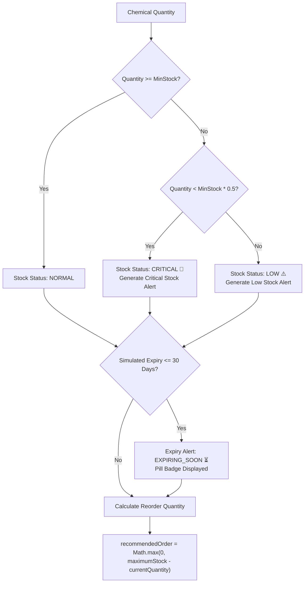

# Breaking Bad Heisenberg: Chemical Lab Supply Intelligence 🧪⚡

**A Cloud-Based Simulated Laboratory Inventory & Supply Intelligence Dashboard**  
*College Cloud Technology Micro-Project | ₹0 Free Tier Spark Plan Compliance*

---

> [!NOTE]
> **Educational Simulation Notice:**  
> This project is designed strictly for academic demonstration and simulation purposes. All chemical inventory records, suppliers, and stock transactions utilize safe, fictional laboratory sample data. No real-world procurement or hazardous handling functionality is implemented.

---

## 📌 1. Project Overview

**Breaking Bad Heisenberg: Chemical Lab Supply Intelligence** is a lightweight, modern serverless web application that demonstrates cloud computing principles, NoSQL document databases, real-time data streaming, and automated supply-chain intelligence.

The application allows laboratory administrators and researchers to monitor chemical stock levels, log simulated Stock-IN (restock) and Stock-OUT (experiment consumption) transactions, automatically detect low-stock and expiring reagents, and generate dynamic procurement recommendations.

---

## 🎯 2. Problem Statement & Objectives

### Problem Statement
Traditional educational chemistry laboratories frequently suffer from inaccurate manual paper logging, delayed stockouts of critical reagents during practical examinations, undiscovered shelf-life expirations, and uncoordinated procurement cycles.

### Project Objectives
1. **Cloud Centralization:** Provide a centralized cloud dashboard for chemical tracking accessible from any web browser.
2. **Autonomous Supply Intelligence:** Automatically compute stock health statuses (`NORMAL`, `LOW`, `CRITICAL`), flag upcoming shelf expirations ($\le 30$ days), and recommend replenishment quantities.
3. **Immutable Audit Ledger:** Maintain a timestamped history of all stock movements for laboratory safety and inventory auditing.
4. **₹0 Budget Compliance:** Architect the application entirely within the **Firebase Spark Plan** perpetual free tier without requiring credit cards or Cloud Functions.

---

## 🛠️ 3. Technology Stack

- **Frontend:** Semantic HTML5, Vanilla CSS3 (Custom Laboratory Dark Theme with Glassmorphism), Modern Vanilla JavaScript (ES6 Modules).
- **Charts & Visualization:** Chart.js (via CDN with fallback).
- **Cloud Infrastructure:**
  - **Firebase Hosting:** High-speed Content Delivery Network (CDN) with automated SSL.
  - **Google Cloud Firestore:** Scalable NoSQL real-time document store.
  - **Firebase Web SDK v10:** Direct modular client-to-cloud communication.

---

## ☁️ 4. Cloud Architecture

```mermaid
graph TD
    User([Lab Researcher / Student]) -->|HTTPS Web Traffic| CDN[Firebase Hosting CDN]
    CDN -->|Serves Static Bundle| Browser[Web Browser / DOM]
    Browser -->|Direct Web SDK v10 gRPC/HTTPS| Firestore[(Google Cloud Firestore)]
    
    subgraph Client-Side Intelligence Engine
        IE1[Stock Status Rules]
        IE2[Reorder Math Formula]
        IE3[Expiry Detector]
        IE4[Overdraw Prevention Safety]
    end

    Browser --- Client-Side Intelligence Engine

    subgraph Firestore Collections
        Col1[(chemicals)]
        Col2[(suppliers)]
        Col3[(transactions)]
        Col4[(alerts)]
    end

    Firestore --- Col1
    Firestore --- Col2
    Firestore --- Col3
    Firestore --- Col4
```

---

## 🗄️ 5. Database Design (Firestore Collections)

| Collection | Key Fields | Purpose |
| :--- | :--- | :--- |
| `chemicals` | `id`, `name`, `category`, `quantity`, `unit`, `minimumStock`, `maximumStock`, `expiryDate`, `storageLocation`, `supplierId`, `status`, `createdAt` | Stores simulated chemical items and live inventory balance (`status` is `NORMAL`, `LOW`, or `CRITICAL`). |
| `suppliers` | `id`, `name`, `contact`, `location`, `rating` | Directory of fictional laboratory vendors. |
| `transactions` | `id`, `chemicalId`, `chemicalName`, `type` (`IN`/`OUT`), `quantity`, `timestamp`, `notes`, `supplierId` | Immutable audit log of all stock movements. (`supplierId` is stored for Stock-IN only; omitted on Stock-OUT). |
| `alerts` | `id`, `chemicalId`, `type`, `severity`, `message`, `timestamp`, `resolved` | Alert schema provisioned for broadcasts. Operational inventory alerts are computed client-side in real time to preserve the ₹0 Spark Plan write quota. |

---

## 🧠 6. Inventory Intelligence Logic



### Mathematical Formulas & Business Rules:
1. **Stock Status:** Evaluates stock quantity balance against predefined thresholds:
   - $\text{NORMAL}$: $\text{Quantity} \ge \text{MinimumStock}$
   - $\text{LOW}$: $0.5 \times \text{MinimumStock} \le \text{Quantity} < \text{MinimumStock}$
   - $\text{CRITICAL}$: $\text{Quantity} < 0.5 \times \text{MinimumStock}$
2. **Shelf-Life & Expiry Alert:** Evaluated independently from stock balance:
   - If $\text{Days to Expiry} \le 0$: Flagged as $\text{EXPIRED}$
   - If $0 < \text{Days to Expiry} \le 30$: Flagged as $\text{EXPIRING\_SOON}$
   - *Note: Expiry alerts are orthogonal to stock status (a chemical can have NORMAL stock while simultaneously being EXPIRING_SOON).*
3. **Reorder Recommendation:**
   $$\text{RecommendedOrder} = \max(0, \text{MaximumStock} - \text{CurrentQuantity})$$
4. **Spark Plan Write Protection:** Operational alerts are generated client-side from the reactive Firestore `chemicals` stream (`onSnapshot`), completely eliminating unnecessary Firestore write calls and guaranteeing ₹0 free-tier operation.

---

## 📂 7. Project File Structure

```
heisenberg-lab/
│
├── index.html              # Main responsive laboratory dashboard
├── styles.css              # Dark laboratory design system & glassmorphism
├── app.js                  # Business rules, state management, and UI logic
├── firebase-config.js      # Firebase Web SDK integration & fallback data store
├── firestore.rules         # Security & transaction immutability rules
├── firebase.json           # Firebase CLI Hosting configuration
├── .firebaserc             # Firebase project alias
├── README.md               # Project documentation
│
├── assets/
│   └── logo.svg            # Periodic table 'Br' laboratory badge
│
└── docs/
    ├── architecture.md     # Cloud architecture & Spark Plan breakdown
    ├── database.md         # Firestore collection schemas & ER diagrams
    ├── data-flow.md        # Stock-IN/OUT sequence diagrams & math
    ├── deployment.md       # Step-by-step Firebase deployment guide
    └── viva-questions.md   # Top 20 viva examination Q&As
```

---

## 🚀 8. Quick Start & Local Testing

The project contains a **Dual-Mode Data Access Layer**. It runs instantly out-of-the-box in local simulation mode and automatically switches to live Cloud Firestore once Firebase keys are configured!

### Running Locally:
```bash
# Navigate to project directory
cd C:\Users\binoy\.gemini\antigravity-ide\scratch\heisenberg-lab

# Start local HTTP server using Python 3
python -m http.server 8080

# Or using Node's npx
npx -y http-server . -p 8080
```
Open **`http://localhost:8080`** in your browser.

Click **⚡ Seed Sample Lab Data** to populate realistic educational records (Acetone, Ethanol, Hydrochloric Acid, Distilled Water, Iodine Solution, etc.).

---

## ☁️ 9. Deploying to Google Firebase

### Step 1: Create Firebase Project
1. Go to [Firebase Console](https://console.firebase.google.com/) and click **Add Project** (Spark Free Plan).
2. Add a **Web App (`</>`)** to obtain your `firebaseConfig` object.
3. In sidebar, go to **Build > Firestore Database** and click **Create Database** (Start in Test Mode).

### Step 2: Configure Environment / `firebase-env.js`
Copy `firebase-env.example.js` to `firebase-env.js` (which is git-ignored) and add your API key:
```javascript
window.__FIREBASE_ENV__ = {
  apiKey: "YOUR_FIREBASE_API_KEY"
};
```
Or define your config in [firebase-config.js](file:///C:/Users/binoy/.gemini/antigravity-ide/scratch/heisenberg-lab/firebase-config.js):
```javascript
export const firebaseConfig = {
  apiKey: "YOUR_FIREBASE_API_KEY",
  authDomain: "your-project.firebaseapp.com",
  projectId: "your-project",
  storageBucket: "your-project.appspot.com",
  messagingSenderId: "...",
  appId: "..."
};
```

### Step 3: Deploy via Firebase CLI
```bash
# Login to Firebase
firebase login

# Set your project
firebase use --add

# Deploy to Firebase Hosting & apply Firestore Rules
firebase deploy
```
Your application will be live at `https://<your-project-id>.web.app`!

---

## 🎓 10. Viva Highlights & Key Takeaways

1. **Why No Cloud Functions?** Cloud Functions require a billing account (Blaze plan). Moving the intelligence engine to client-side Vanilla JS preserves 100% functionality at ₹0 cost.
2. **Safety Validations:** Stock-OUT transactions strictly enforce `requestedQuantity <= currentQuantity`, preventing negative inventory errors.
3. **Transaction Immutability:** Audit transactions cannot be updated or deleted (`allow update, delete: if false`), satisfying laboratory regulatory standards.

---
*Created for Cloud Computing Micro-Project Demonstration & Evaluation.*
