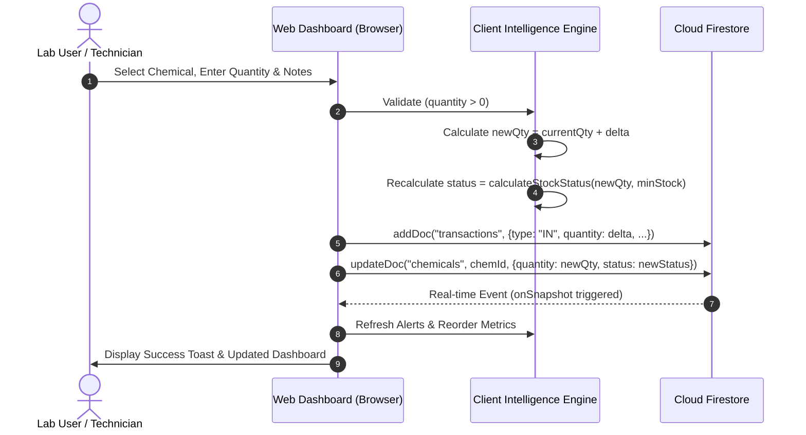
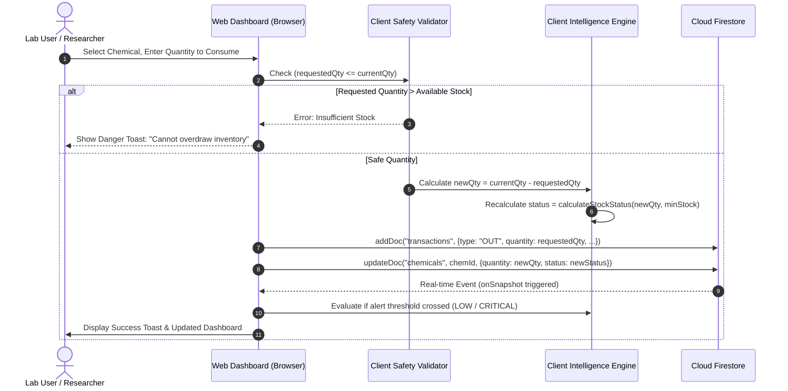
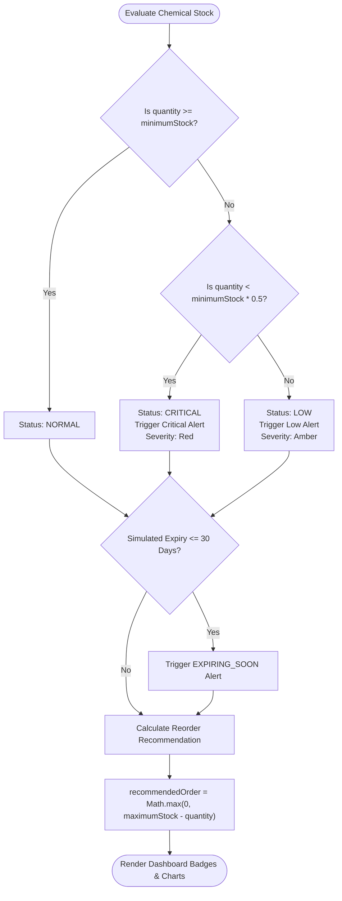

# Data Flow & Simulation Workflows

## Breaking Bad Heisenberg: Chemical Lab Supply Intelligence

This document specifies the exact sequence of events, math equations, and state transitions for simulation workflows.

---

## 1. Stock-IN (Restock / Procurement) Data Flow

When a lab technician or researcher records a chemical restock:

---

## 2. Stock-OUT (Consumption) Data Flow (With Safety Guard)

When a chemical is consumed for an experiment, the system strictly protects against overdraw:

---

## 3. Inventory Intelligence Decision Logic

---

## 4. Mathematical Formulations

### 4.1 Stock Status Formula
$$\text{Status}(Q, M) = \begin{cases} 
\text{CRITICAL}, & \text{if } Q < 0.5 \times M \\
\text{LOW}, & \text{if } 0.5 \times M \le Q < M \\
\text{NORMAL}, & \text{if } Q \ge M 
\end{cases}$$

*Where $Q$ is current chemical quantity, and $M$ is minimum stock threshold.*

### 4.2 Automated Reorder Quantity Formula
$$\text{Reorder Quantity}(Q, \text{Max}) = \begin{cases}
0, & \text{if } Q \ge \text{Max} \\
\text{Max} - Q, & \text{if } Q < \text{Max}
\end{cases}$$

*Where $\text{Max}$ is the maximum target storage capacity.*

### 4.3 Shelf-Life Expiry Warning Formula
$$\Delta T = \text{Date}_{\text{expiry}} - \text{Date}_{\text{today}}$$
$$\text{Expiry Alert} = \begin{cases}
\text{EXPIRED}, & \text{if } \Delta T < 0 \\
\text{EXPIRING\_SOON}, & \text{if } 0 \le \Delta T \le 30\text{ days} \\
\text{VALID}, & \text{if } \Delta T > 30\text{ days}
\end{cases}$$
