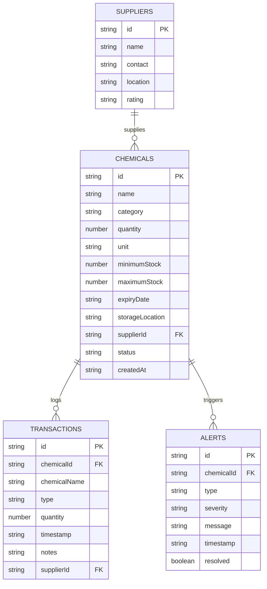

# Database Schema & Data Modeling

## Breaking Bad Heisenberg: Chemical Lab Supply Intelligence

This document outlines the NoSQL schema design, data types, validation rules, and collection structures implemented in **Google Cloud Firestore**.

---

## 1. Database Model: Document-Oriented NoSQL

Cloud Firestore structures data into **Collections** containing flexible JSON-like **Documents**. 



---

## 2. Collections Specification

### 2.1 Collection: `chemicals`
Represents individual simulated chemical inventory entries.

| Field Name | Type | Description | Example Value |
| :--- | :--- | :--- | :--- |
| `id` | `String` | Document unique identifier (human-readable slug based on chemical name) | `"Acetone"`, `"Sodium_Chloride"` |
| `name` | `String` | Chemical name and specification | `"Acetone (High Purity ACS)"` |
| `category` | `String` | Classification group | `"Solvent"`, `"Acid"`, `"Base"`, `"Salt"`, `"Indicator"`, `"Reagent"` |
| `quantity` | `Number` | Current available laboratory volume/mass | `45.0` |
| `unit` | `String` | Unit of measure | `"L"`, `"mL"`, `"kg"`, `"g"`, `"Bottles"` |
| `minimumStock` | `Number` | Threshold below which reorders are triggered | `20.0` |
| `maximumStock` | `Number` | Target storage capacity limit | `100.0` |
| `expiryDate` | `String` | Simulated shelf-life expiration (ISO 8601 Date) | `"2027-10-15"` |
| `storageLocation` | `String` | Physical laboratory compartment / safety rack | `"Flammables Cabinet F-1"` |
| `supplierId` | `String` | Reference to the preferred supplier | `"supp_abq"` |
| `status` | `String` | Stock quantity balance status (`"NORMAL"`, `"LOW"`, `"CRITICAL"`). *Note: Expiry (`EXPIRING_SOON` / `EXPIRED`) is evaluated dynamically from `expiryDate` rather than mutating this stock balance field.* | `"NORMAL"` |
| `createdAt` | `String` | ISO 8601 timestamp of chemical registration | `"2026-10-06T12:00:00.000Z"` |

---

### 2.2 Collection: `suppliers`
Stores records of registered fictional chemical suppliers and distributors.

| Field Name | Type | Description | Example Value |
| :--- | :--- | :--- | :--- |
| `id` | `String` | Document unique identifier (prefixed `supp_*`) | `"supp_abq"` |
| `name` | `String` | Vendor / Company name | `"Albuquerque Scientific Reagents"` |
| `contact` | `String` | Direct email or phone contact | `"orders@abqscientific.com"` |
| `location` | `String` | Vendor geographic warehouse location | `"Albuquerque, New Mexico"` |
| `rating` | `String` | Vendor quality and reliability score | `"5.0"` |

---

### 2.3 Collection: `transactions`
Provides an immutable audit log of all stock movements (Stock-IN restocks and Stock-OUT lab consumptions).

| Field Name | Type | Description | Example Value |
| :--- | :--- | :--- | :--- |
| `id` | `String` | Transaction document unique identifier | `"tx_init_1"` |
| `chemicalId` | `String` | ID of the affected chemical | `"chem_acetone"` |
| `chemicalName` | `String` | Denormalized chemical name for fast log queries | `"Acetone (High Purity ACS)"` |
| `type` | `String` | Transaction classification | `"IN"` (Restock) or `"OUT"` (Consumption) |
| `quantity` | `Number` | Volume or mass moved during transaction | `25.0` |
| `timestamp` | `String` | Single canonical ISO 8601 audit timestamp | `"2026-10-06T15:30:00.000Z"` |
| `notes` | `String` | Purpose, experiment title, or PO number | `"Titration Analysis Session Demo"` |
| `supplierId` | `String` | Associated supplier ID (for Stock-IN only; omitted on Stock-OUT) | `"supp_abq"` |

---

### 2.4 Collection: `alerts`
Defines the schema for automated and system-wide inventory intelligence alerts.

| Field Name | Type | Description | Example Value |
| :--- | :--- | :--- | :--- |
| `id` | `String` | Alert document unique identifier (`alt_*`) | `"alt_crit_chem_hcl"` |
| `chemicalId` | `String` | Foreign key referencing chemical | `"chem_hcl"` |
| `type` | `String` | Alert category code | `"LOW_STOCK"`, `"CRITICAL_STOCK"`, `"EXPIRING_SOON"` |
| `severity` | `String` | Visual severity grade | `"critical"`, `"warning"`, `"expiring"`, `"info"` |
| `message` | `String` | Human-readable alert summary | `"CRITICAL STOCK: Hydrochloric Acid is at 3 L (<50% of min)"` |
| `timestamp` | `String` | ISO 8601 timestamp when alert condition occurred | `"2026-10-06T16:00:00.000Z"` |
| `resolved` | `Boolean`| Resolution status flag | `false` |

> [!NOTE]
> **₹0 Spark Plan Optimization:** To stay strictly within Firebase Cloud Firestore's free-tier write quota (20,000 writes/day), operational inventory alerts (`LOW_STOCK`, `CRITICAL_STOCK`, `EXPIRING_SOON`) are generated **dynamically in-memory** on the client from the real-time `chemicals` stream (`onSnapshot`). The `/alerts` Firestore collection and security rules remain provisioned for persistent broadcast notices and cross-terminal sync, avoiding unnecessary write operations on simulated stock threshold checks.

---

## 3. Immutability & Audit Principles

In chemical supply intelligence and laboratory inventory systems, regulatory compliance requires that stock transactions cannot be retroactively altered or deleted. 
This is strictly enforced in `firestore.rules`:
```javascript
match /transactions/{transactionId} {
  allow read: if true;
  allow create: if hasValidTransactionData();
  allow update, delete: if false; // Immutable audit log
}
```

### 3.1 Atomic Document Creation (`createDocument`)
To prevent overwrite races when creating chemicals or suppliers with human-readable IDs (e.g. `Acetone`, `Sodium_Chloride`, `Hydrochloric_Acid`), document creation in live Firestore executes atomically within a `runTransaction()` block. The transaction first reads `transaction.get(docRef)`, verifies that the target document does not exist, and atomically writes the new record with `transaction.set(docRef, payload)`. If a collision is detected, an `already-exists` error is thrown, allowing the client UI to automatically retry with an incremented counter candidate (`Name_2`, `Name_3`, etc.) without overwriting existing data.


